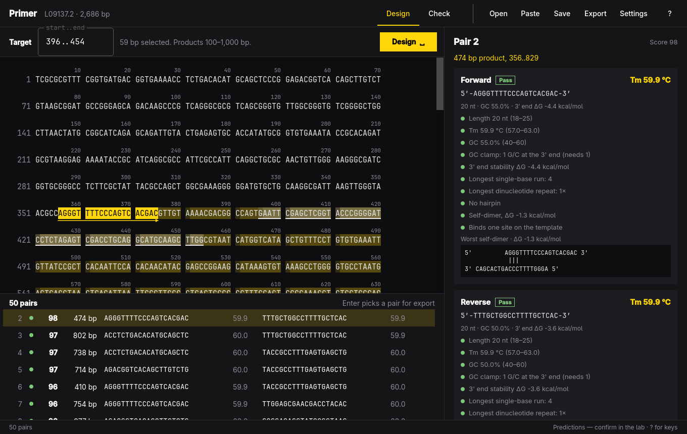

# Primer



Design and check PCR primers for a target sequence, from the keyboard. Paste a
template or open a FASTA or GenBank file, drag across the region you want to
amplify, and press Space: Primer ranks forward/reverse pairs that flank it and
shows why each one passes, warns, or fails. Check mode does the same for
primers you already have, with or without a template.

> **Every number here is a prediction.** Melting temperatures, structures, and
> binding sites come from thermodynamic models and simple sequence rules, not
> from your reaction. Confirm primers in the lab (a gradient PCR, a gel, a
> melt curve) before you rely on them.

## Install

On Omarchy:

```sh
bin/install
```

This builds the app and installs it as an Arch package, so it shows up in the
app launcher (Super + Space). Primer follows the Omarchy theme accent, window
rounding, and language as they change.

## Using it

1. **Template.** Paste a sequence (Ctrl+V, or the box shown when nothing is
   open) or open a `.fasta`, `.gb`, or `.primer` file (Ctrl+O). The sequence is
   wrapped in groups of ten under a position ruler.
2. **Target.** Drag across the bases to amplify, or type `start..end` (1-based,
   inclusive) into the Target field.
3. **Design.** Press Space. Pairs appear ranked by score; J/K or the arrow keys
   move through them, and the current pair's primers and amplicon are
   highlighted on the sequence, with arrows pointing to each 3′ end.
4. **Pick.** Enter picks the current pair for export (✓). Ctrl+E exports the
   picked pairs, or the current one if none are picked, as a CSV oligo order
   or a PDF/SVG report.
5. **Check.** Press C to check your own primers. A reverse primer is optional;
   a template is optional too, and is only needed for binding sites and the
   product size.

Ctrl+S saves the template, target, settings, picks, and check-mode primers as
a `.primer` file. The originals you opened are never written to.

### Keys

| Key | Action |
| --- | --- |
| Space | Design pairs for the target (check mode: focus the primer field) |
| J / K, ↓ / ↑ | Next and previous pair |
| Enter | Pick or unpick the pair for export |
| C | Switch between design and check |
| / | Search the sequence (both strands), or type a position to jump to |
| S | Settings |
| Ctrl+O | Open a template or `.primer` file |
| Ctrl+V | Paste a template |
| Ctrl+S / Ctrl+Shift+S | Save / Save as |
| Ctrl+E | Export CSV, PDF, or SVG |
| Ctrl+Z / Ctrl+Shift+Z | Undo / Redo |
| Esc | Close an overlay, or leave a field |
| ? | Show the keys |
| Q | Quit (asks first when there are unsaved changes) |

## Command line

The same engine runs without a window, for scripts and agents. Every command
takes `--json`, writes errors to stderr, and exits 0 or 1.

```sh
primer tm AGCGGATAACAATTTCACACAGGA                 # 60.8 °C
primer tm AGCGGATAACAATTTCACACAGGA --na 50 --mg 2 --dntp 0.8 --conc 250
primer check GTAAAACGACGGCCAGT CAGGAAACAGCTATGAC --template examples/pUC19.fasta
primer design examples/pUC19.fasta --region 396..454 --csv order.csv --report report.pdf
primer skill install                               # a short skill for coding agents
```

`check` exits 1 when any check fails; `design` exits 1 when no pair passes.
Settings for both: `--length 18-25 --length-opt 20 --tm 57-63 --tm-opt 60
--tm-diff 2 --gc 40-60 --clamp 1 --product 100-1000 --pairs 50`, and reaction
conditions `--na` (mM), `--mg` (mM), `--dntp` (mM, total), `--conc` (nM, each
primer). `primer open <file>` opens the window.

## How Tm is calculated

Primer uses the unified nearest-neighbor parameters of SantaLucia (1998),
*PNAS* 95:1460–1465, Table 2, the same model Primer3 uses by default.

For a primer of N bases paired with its perfect complement:

```
ΔH° = Σ ΔH°(stacks) + ΔH°init(5′ end) + ΔH°init(3′ end)
ΔS° = Σ ΔS°(stacks) + ΔS°init(5′ end) + ΔS°init(3′ end) [+ ΔS°sym]
```

- Ten stacks (AA/TT, AT/TA, … GC/CG) in kcal/mol and cal/(K·mol).
- Initiation per terminal pair: G·C 0.1 kcal/mol, −2.8 cal/(K·mol);
  A·T 2.3 kcal/mol, 4.1 cal/(K·mol).
- ΔS°sym = −1.4 cal/(K·mol) for a self-complementary primer.

**Salt.** Mg²⁺ stabilizes a duplex far more than Na⁺, but dNTPs bind it, so
only the free Mg²⁺ is counted. It is folded into a sodium equivalent (von Ahsen
et al. 2001, *Clin. Chem.* 47:1956), all in mM:

```
[Na⁺]eq = [Na⁺] + 120 · √([Mg²⁺] − [dNTP])      (the root term is 0 when [dNTP] ≥ [Mg²⁺])
```

The entropy then takes SantaLucia's (1998) salt correction, with [Na⁺]eq in M:

```
ΔS°salt = ΔS° + 0.368 · (N − 1) · ln[Na⁺]eq
```

**Tm.** With R = 1.987 cal/(K·mol) and CT the concentration of each primer
strand (M):

```
Tm = 1000 · ΔH° / (ΔS°salt + R · ln(CT / 4)) − 273.15      (°C)
```

and `R · ln(CT)` for a self-complementary primer. The defaults match Primer3's:
50 mM Na⁺, 1.5 mM Mg²⁺, 0.6 mM dNTP, 50 nM primer. The tests check Primer's
values against Primer3 (primer3-py 2.4.0) for five common primers under three
salt conditions; they agree within 0.01 °C.

## What is checked

Each primer, then each pair, gets pass, warn, or fail on these:

| Check | Pass | Warn | Fail |
| --- | --- | --- | --- |
| Length | in the set range (18–25) | up to 5 nt outside | further |
| Tm | in range (57–63 °C) | up to 2 °C outside | further |
| GC % | in range (40–60) | up to 5 points outside | further |
| GC clamp | ≥ the set number of G/C at the 3′ end (1) | fewer, or > 3 G/C in the last 5 bases | — |
| 3′ end stability | ΔG of the last 5 bases above −9 kcal/mol | −9 or below | — |
| Single-base runs | ≤ 4 | 5 | > 5 |
| Dinucleotide repeats | ≤ 3 | 4 | ≥ 5 |
| Hairpin, 3′ end paired | ΔG above −2 | −2 to −3 | −3 or below |
| Hairpin, internal | above −3 | −3 to −6 | −6 or below |
| Self-dimer / cross-dimer, 3′ end paired | above −5 | −5 to −7 | −7 or below |
| Self-dimer / cross-dimer, internal | above −6 | −6 to −9 | −9 or below |
| Binding sites (with a template) | exactly one | none | more than one |
| Pair Tm difference | ≤ the set maximum (2 °C) | up to 2 °C more | further |
| Product (with a template) | one product in the size range | one, outside the range | none, or more than one |

ΔG values are kcal/mol at 37 °C, under the reaction's salt.

**Structures.** Dimers and hairpins are scored with the same nearest-neighbor
stacks: every perfectly paired stretch of three or more base pairs between two
strands (dimers), or closing a loop of three or more bases (hairpins, with
loop penalties from SantaLucia and Hicks 2004, *Annu. Rev. Biophys. Biomol.
Struct.* 33:415). The worst one is drawn as aligned base pairs. Structures
that pair a 3′ end are held to stricter limits, because the polymerase can
extend them. This model does not score mismatches, bulges, terminal
mismatches, or dangling ends inside a structure, so for gapped structures it
reads less stable than Primer3's thermodynamic alignment (for perfect duplexes
the two agree within about 0.1 kcal/mol).

**Binding sites.** A primer binds wherever its last 8 bases (the 3′ end) match
the template exactly and the rest has at most 3 mismatches, on either strand.
A product is any forward-strand site and reverse-strand site of either primer
facing each other within 5 kb.

**Scoring.** A pair's penalty adds, for each primer, 1 per °C from the best
Tm, 0.5 per nt from the best length, 0.05 per GC point from the middle of the
range, the excess stability of its worst hairpin, self-dimer, and 3′ end, and 1
per warning; then the pair's Tm difference and 1 per pair warning. The score is
100 − 5 × penalty, from 0 to 100. Pairs with any failure are not offered.

## Files

- **.primer**: JSON with the template, target, settings, picked pairs, and
  check-mode primers. Designs are recomputed when the file opens.
- **CSV** for an oligo order: `Name, Sequence (5'-3'), Length, Tm (C), GC %,
  Product size (bp)`, one row per primer, named `<template>_F1`, `_R1`, …
- **PDF / SVG** report: conditions, then each pair with every check and
  structure.

`examples/pUC19.fasta` is GenBank L09137.2, the pUC19 cloning vector, for
trying it out: its multiple cloning site is 396..454.

## Development

```sh
bin/build          # build/primer
bin/test           # Qt Test, offscreen
build/primer examples/pUC19.fasta
```

C++17 and Qt 6 Quick, built with qmake6. The thermodynamics, checks, and
design are plain C++ in `src/thermo.cpp`, `src/checks.cpp`, and
`src/dna.cpp`; the window is `src/Main.qml`. Translations live in
`src/i18n/` (English and Danish).

## License

MIT. See [LICENSE](LICENSE).
